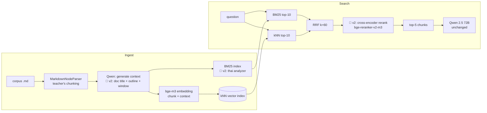

# Authentic RAG v2 — ปรับปรุง Retrieval สำหรับเอกสารภาษาไทย

Assignment วิชา Natural Language Processing (KDAI, KMITL) — Part 4: RAG Theory

ต่อยอดจาก [Authentic RAG ของ อ.เอกนันท์](https://github.com/aekanun2020/2025-authenticRAG) (Contextual Retrieval + Hybrid search บน OpenSearch) โดยปรับเฉพาะฝั่ง **retrieval** (context generation, analyzer, reranking) **ไม่เปลี่ยน LLM ที่ใช้ generate คำตอบ** (Qwen 2.5 72B ผ่าน OpenRouter, prompt และ temperature เดิม) แล้ววัดผลแบบ ablation ทีละขั้น

---

## TL;DR

| | Baseline (ข้อ 1) | v2 (ข้อ 2) |
|---|---|---|
| Context ของแต่ละ chunk | LLM เห็นแค่ **chunk ตัวเอง** (โค้ดส่ง chunk เป็น `<document>`) | LLM เห็น **ชื่อเรื่อง + สารบัญ + ข้อความรอบ chunk** |
| BM25 analyzer | `standard` (ตัดคำไทยไม่ได้) | `thai` (ตัดคำด้วย dictionary) |
| Reranking | ไม่มี (RRF อย่างเดียว) | Cross-encoder `BAAI/bge-reranker-v2-m3` |
| Generator | Qwen 2.5 72B | **เหมือนเดิม** |

ผลลัพธ์ทั้งหมดอยู่ที่ [ผลการทดลอง](#ผลการทดลอง-ข้อ-3) ด้านล่าง (ตัวเลขถูกเติมอัตโนมัติจาก `eval/report.py`)

---

## สถาปัตยกรรม



🔧 = จุดที่ v2 เปลี่ยนจาก baseline

---

## ข้อ (1) Baseline: Authentic RAG ตามสไลด์หน้า 22, 25

โค้ดของอาจารย์อยู่ใน [`baseline/`](baseline/) **โดยไม่แก้ไข** ใช้ corpus เดิม 4 ไฟล์ (หัดเยอรมัน, อหิวาตกโรค, ต้อกระจก, กรดไหลย้อน) แบ่งได้ 53 chunks

- `baseline/authenticRAG.py` — Hands-on 1: นำเข้าเอกสาร → `anthropic-vector-index`, `anthropic-bm25-index`
- `baseline/onlysearchAuthenticRAG.py` — Hands-on 2: ค้น + ตอบคำถาม 5 ข้อของอาจารย์ → `results/baseline_answers.json`
- log การรันจริงอยู่ใน `results/logs/`

## ข้อ (2) สิ่งที่ปรับปรุง

### 2.1 Doc-aware contextual embedding (แก้ bug)

ใน `authenticRAG.py` บรรทัดที่สร้าง context:

```python
full_doc_content = doc.page_content  # ถ้าไม่มีเอกสารเต็ม ใช้ chunk เอง
context = self.generate_context(full_doc_content, doc.page_content)
```

ตัวแปร `full_doc_content` คือ **chunk ตัวเอง** ไม่ใช่เอกสารเต็ม ทำให้ prompt ของ Anthropic กลายเป็น "ช่วยระบุตำแหน่งของ chunk นี้ในเอกสาร...ซึ่งก็คือ chunk นี้" LLM จึงทำได้แค่สรุป chunk ซ้ำ ไม่ได้เพิ่มข้อมูลที่ chunk ขาด (เช่น chunk นี้อยู่ในเรื่องโรคอะไร หัวข้อใหญ่คืออะไร) ซึ่งเป็นหัวใจของ Contextual Retrieval

**v2** (`improved/ingest_v2.py`) ส่งเอกสารจริงให้ LLM โดยใช้ prompt เดิมทุกตัวอักษร เอกสารแต่ละไฟล์ยาว ~50–65K ตัวอักษร จึงส่งเป็น **ชื่อเรื่อง + สารบัญ (ทุก heading) + ข้อความรอบ chunk** จำกัดที่ `CONTEXT_WINDOW_CHARS` (default 12,000) เพื่อให้พอดี context ของ Qwen

### 2.2 Thai analyzer สำหรับ BM25

สไลด์หน้า 24 แสดง term `"และวิธีการรักษา"` เป็น **token เดียว** เพราะ `standard` analyzer (Unicode word boundary) ไม่รู้จักขอบเขตคำไทย ข้อความไทยที่ไม่มีช่องว่างจึงกลายเป็นก้อนยาวก้อนเดียว ผลคือ query จะ match ได้เฉพาะเมื่อพิมพ์ก้อนนั้นตรงทุกตัวอักษร BM25 ฝั่ง sparse ของ hybrid search แทบไม่ทำงานกับภาษาไทย

**v2** สร้าง BM25 index อีกชุดด้วย `thai` analyzer ที่มีมากับ OpenSearch (ตัดคำด้วย dictionary) ไม่ต้องลง plugin เพิ่ม

### 2.3 Cross-encoder reranking

สไลด์หน้า 17 อธิบายว่า Contextual Retrieval มีขั้น Reranking แต่ Authentic RAG (หน้า 20) มีแค่ Rank fusion ซึ่งรวมอันดับจาก 2 retriever โดยไม่ได้อ่านเนื้อหาเทียบกับคำถามเลย

**v2** นำ candidate ทั้งหมดจาก RRF (≤20 chunks) ส่งให้ `BAAI/bge-reranker-v2-m3` (multilingual cross-encoder รองรับไทย) ให้คะแนนคู่ (question, context + chunk) แล้วจัดอันดับใหม่ก่อนตัด top-5 ส่งให้ LLM

### ส่วนที่คงไว้เหมือนเดิม (เพื่อให้เปรียบเทียบได้ตรง)

Chunking (`MarkdownNodeParser`), embedding model (`bge-m3`), schema ของ vector index, query ของ BM25/kNN, RRF k=60, จำนวน candidate (k×2 ต่อ retriever), prompt สร้าง context, LLM, prompt และ temperature ตอน generate คำตอบ

---

## วิธีประเมินผล

### Test set
`eval/make_testset.py` ให้ Qwen สร้างคำถามจาก chunk ที่มีเนื้อหา (ตัด chunk อ้างอิง/ลิงก์ และ chunk สั้น <200 ตัวอักษร) chunk ละ 2 แบบ:

- **exact** — ใช้คำเดียวกับในเอกสาร → ทดสอบ lexical matching (BM25)
- **paraphrase** — ภาษาพูด เลี่ยงคำที่ซ้ำกับเอกสาร → ทดสอบ semantic matching (dense)

Gold label = **hash ของเนื้อหา chunk** จึงใช้ label ชุดเดียวกันกับทุก index ได้ ไฟล์อยู่ที่ [`eval/testset.jsonl`](eval/testset.jsonl)

### Metrics (วัดที่ retrieval โดยตรง)
- **Hit@5 / Fail@5** — chunk ที่ถูกอยู่ใน 5 chunks ที่ส่งให้ LLM หรือไม่ (สิ่งที่ LLM "เห็น" จริง) Fail@5 เป็น metric แบบเดียวกับกราฟของ Anthropic ในสไลด์หน้า 18–19
- **Hit@1, Hit@3, MRR** — chunk ที่ถูกขึ้นอันดับต้นแค่ไหน
- **Gold in candidate pool** — chunk ที่ถูกอยู่ใน candidate ก่อน rerank หรือไม่ = เพดานที่ reranker ทำได้
- **Latency** ต่อ query

**ทำไมไม่วัดคุณภาพคำตอบ:** ทุกการปรับปรุงอยู่ฝั่ง retrieval และ generator ถูก fix ไว้ การวัดที่ retrieval จึงแยกผลของแต่ละการเปลี่ยนแปลงได้ชัดกว่า และไม่มี noise จาก LLM (temperature 0.6) ส่วนคำตอบจริงของคำถาม 5 ข้อของอาจารย์ เทียบไว้ใน [`results/answers_compare.md`](results/answers_compare.md)

### Ablation
เพิ่มการเปลี่ยนแปลงทีละอย่าง เพื่อให้ตอบได้ว่าส่วนต่างมาจากอะไร

| Config | Vector index | BM25 index | Rerank |
|---|---|---|---|
| C0 Baseline | `anthropic-vector-index` (context จาก chunk) | `anthropic-bm25-index` (standard) | – |
| C1 + Doc-aware context | `v2-vector-index` | `v2-bm25-standard` | – |
| C2 + Thai analyzer | `v2-vector-index` | `v2-bm25-thai` | – |
| C3 + Reranker | `v2-vector-index` | `v2-bm25-thai` | ✓ |

---

## ผลการทดลอง (ข้อ 3)

### ภาพรวม

<!-- ABLATION:START -->
_run `./run_all.sh`_
<!-- ABLATION:END -->

### แยกตามประเภทคำถาม

<!-- BYTYPE:START -->
<!-- BYTYPE:END -->

### แยกตาม retriever (ก่อน fusion) — ดูว่าแต่ละขาทำงานแค่ไหน

<!-- COMPONENT:START -->
<!-- COMPONENT:END -->

### หลักฐาน: tokenization ของ `standard` vs `thai`

<!-- TOKENS:START -->
<!-- TOKENS:END -->

### หลักฐาน: context ที่ LLM สร้าง (baseline vs v2)

<!-- CONTEXT:START -->
<!-- CONTEXT:END -->

### ตัวอย่างคำถามที่ v2 แก้ได้

<!-- EXAMPLES:START -->
<!-- EXAMPLES:END -->

### สรุป: ต่างกันตรงไหน ดีขึ้นอย่างไร เพราะอะไร

<!-- ANALYSIS:START -->
_จะเขียนหลังได้ผลการทดลองจริง_
<!-- ANALYSIS:END -->

---

## ข้อจำกัด

- **Synthetic test set** ถูกสร้างจาก chunk โดยตรง คำถามแบบ exact จึงเอื้อต่อ lexical matching เกินจริง และคำถามแต่ละข้ออาจมีคำตอบอยู่ในมากกว่า 1 chunk (เช่น "อาการ" อยู่ทั้งในหัวข้อภาพรวมและหัวข้ออาการ) metric จึงประเมินต่ำกว่าจริง แต่ต่ำเท่ากันทุก config
- **Corpus เล็ก** (4 เอกสาร, 53 chunks) ขนาดผลต่างอาจไม่เท่าเดิมบน corpus ใหญ่
- **Reranker เพิ่ม latency** ดูคอลัมน์ Latency/query ในตาราง
- **ไม่ได้ปรับ chunking** chunk ใหญ่สุดยาว ~8,400 ตัวอักษร (`MarkdownNodeParser` ตัดตาม heading เท่านั้น ไม่สนใจ `chunk_size`) เป็น future work ที่น่าทำต่อ แต่ต้องสร้าง test set ใหม่เพราะ gold chunk เปลี่ยน

## Future work
- Chunking แบบ header-aware + ขนาดคงที่ + overlap
- ปรับ weight ของ RRF / จำนวน candidate ต่อ retriever
- Relevance gating ก่อนส่งเข้า LLM (ตัด chunk ที่ reranker ให้คะแนนต่ำ) เพื่อช่วยคำถามที่ไม่มีคำตอบในเอกสาร

---

## วิธีรัน

```bash
# 1) environment (Python 3.10 ตามคู่มืออาจารย์)
conda create -n advrag python=3.10 -y && conda activate advrag
pip install -r requirements.txt

# 2) OpenSearch (เหมือนคู่มืออาจารย์)
docker run -d --name opensearch -p 9200:9200 -p 9600:9600 \
  -e "discovery.type=single-node" -e "DISABLE_SECURITY_PLUGIN=true" \
  opensearchproject/opensearch:2.19.1

# 3) API key
cp .env.example .env   # แล้วใส่ OPENROUTER_API_KEY

# 4) รันทั้งหมด (baseline → v2 → test set → ablation → report)
./run_all.sh
```

ค่าที่ปรับได้ทั้งหมดอยู่ใน `.env.example` (model, reranker, ขนาด context window, จำนวน worker)

## โครงสร้าง repo

```
baseline/                 โค้ดอาจารย์ (ไม่แก้ไข)            ข้อ (1)
improved/
  common.py               config, chunking เดิม, LLM/OpenSearch client
  ingest_v2.py            doc-aware context + thai BM25        ข้อ (2)
  rag_v2.py               hybrid search + reranker + generate  ข้อ (2)
  ask_v2.py               ตอบคำถาม 5 ข้อของอาจารย์ด้วย v2
eval/
  make_testset.py         สร้าง test set (exact / paraphrase)
  testset.jsonl           test set ที่ใช้จริง
  run_eval.py             ablation C0–C3
  inspect_analyzers.py    เทียบ tokenization standard vs thai
  report.py               สร้างกราฟ + เติมตารางลง README
cache/                    context ที่ LLM สร้าง (baseline / v2)
results/                  metrics, per-query, กราฟ, คำตอบ        ข้อ (3)
corpus_input/             เอกสาร 4 ไฟล์ (จาก repo อาจารย์)
```
