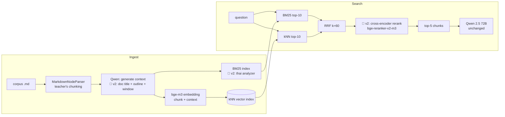
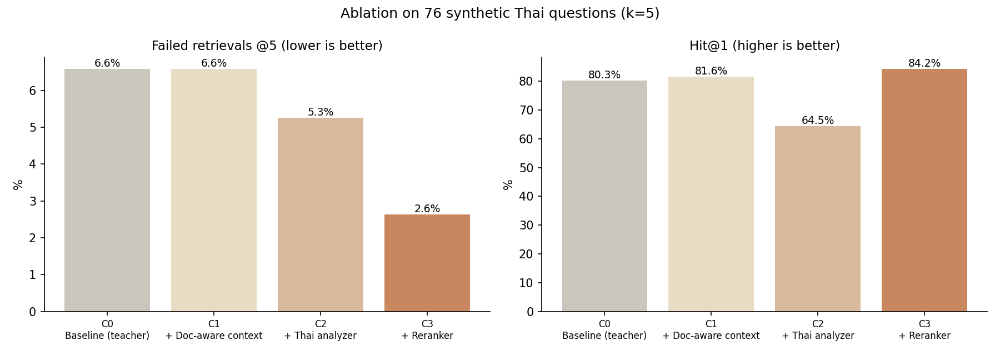

# Authentic RAG v2 — ปรับปรุง Retrieval สำหรับเอกสารภาษาไทย

Assignment วิชา Natural Language Processing (KDAI, KMITL) — Part 4: RAG Theory

ต่อยอดจาก [Authentic RAG ของ อ.เอกนันท์](https://github.com/aekanun2020/2025-authenticRAG) (Contextual Retrieval + Hybrid search บน OpenSearch) โดยปรับเฉพาะฝั่ง **retrieval** (context generation, analyzer, reranking) **ไม่เปลี่ยน LLM ที่ใช้ generate คำตอบ** (Qwen 2.5 72B ผ่าน OpenRouter, prompt และ temperature เดิม) แล้ววัดผลแบบ ablation ทีละขั้น

---

## TL;DR

| | Baseline (ข้อ 1) | v2 (ข้อ 2) |
|---|---|---|
| Context ของแต่ละ chunk | LLM เห็นแค่ **chunk ตัวเอง** (โค้ดส่ง chunk เป็น `<document>`) | LLM เห็น **ชื่อเรื่อง + สารบัญ + ข้อความรอบ chunk** |
| BM25 analyzer | `standard` (ตัดคำไทยไม่ได้) | `thai` (ตัดคำด้วย dictionary) |
| Reranking | ไม่มี (RRF อย่างเดียว) | Cross-encoder `BAAI/bge-reranker-v2-m3` |
| Generator | Qwen 2.5 72B | **เหมือนเดิม** |

**ผลบน test set 76 คำถาม:** Fail@5 ลดจาก 6.6% → 2.6% · Hit@1 80.3% → 84.2% · BM25 ภาษาไทยจาก Hit@5 11.8% → 86.8% (รายละเอียดและข้อแลกเปลี่ยนที่ [ผลการทดลอง](#ผลการทดลอง-ข้อ-3))

---

## สถาปัตยกรรม



🔧 = จุดที่ v2 เปลี่ยนจาก baseline

---

## ข้อ (1) Baseline: Authentic RAG ตามสไลด์หน้า 22, 25

โค้ดของอาจารย์อยู่ใน [`baseline/`](baseline/) **โดยไม่แก้ไข** ใช้ corpus เดิม 4 ไฟล์ (หัดเยอรมัน, อหิวาตกโรค, ต้อกระจก, กรดไหลย้อน) แบ่งได้ 53 chunks

- `baseline/authenticRAG.py` — Hands-on 1: นำเข้าเอกสาร → `anthropic-vector-index`, `anthropic-bm25-index`
- `baseline/onlysearchAuthenticRAG.py` — Hands-on 2: ค้น + ตอบคำถาม 5 ข้อของอาจารย์ → `results/baseline_answers.json`
- log การรันจริงอยู่ใน `results/logs/`

## ข้อ (2) สิ่งที่ปรับปรุง

### 2.1 Doc-aware contextual embedding (แก้ bug)

ใน `authenticRAG.py` บรรทัดที่สร้าง context:

```python
full_doc_content = doc.page_content  # ถ้าไม่มีเอกสารเต็ม ใช้ chunk เอง
context = self.generate_context(full_doc_content, doc.page_content)
```

ตัวแปร `full_doc_content` คือ **chunk ตัวเอง** ไม่ใช่เอกสารเต็ม ทำให้ prompt ของ Anthropic กลายเป็น "ช่วยระบุตำแหน่งของ chunk นี้ในเอกสาร...ซึ่งก็คือ chunk นี้" LLM จึงทำได้แค่สรุป chunk ซ้ำ ไม่ได้เพิ่มข้อมูลที่ chunk ขาด (เช่น chunk นี้อยู่ในเรื่องโรคอะไร หัวข้อใหญ่คืออะไร) ซึ่งเป็นหัวใจของ Contextual Retrieval

**v2** (`improved/ingest_v2.py`) ส่งเอกสารจริงให้ LLM โดยใช้ prompt เดิมทุกตัวอักษร เอกสารแต่ละไฟล์ยาว ~50–65K ตัวอักษร จึงส่งเป็น **ชื่อเรื่อง + สารบัญ (ทุก heading) + ข้อความรอบ chunk** จำกัดที่ `CONTEXT_WINDOW_CHARS` (default 12,000) เพื่อให้พอดี context ของ Qwen

### 2.2 Thai analyzer สำหรับ BM25

สไลด์หน้า 24 แสดง term `"และวิธีการรักษา"` เป็น **token เดียว** เพราะ `standard` analyzer (Unicode word boundary) ไม่รู้จักขอบเขตคำไทย ข้อความไทยที่ไม่มีช่องว่างจึงกลายเป็นก้อนยาวก้อนเดียว ผลคือ query จะ match ได้เฉพาะเมื่อพิมพ์ก้อนนั้นตรงทุกตัวอักษร BM25 ฝั่ง sparse ของ hybrid search แทบไม่ทำงานกับภาษาไทย

**v2** สร้าง BM25 index อีกชุดด้วย `thai` analyzer ที่มีมากับ OpenSearch (ตัดคำด้วย dictionary) ไม่ต้องลง plugin เพิ่ม

### 2.3 Cross-encoder reranking

สไลด์หน้า 17 อธิบายว่า Contextual Retrieval มีขั้น Reranking แต่ Authentic RAG (หน้า 20) มีแค่ Rank fusion ซึ่งรวมอันดับจาก 2 retriever โดยไม่ได้อ่านเนื้อหาเทียบกับคำถามเลย

**v2** นำ candidate ทั้งหมดจาก RRF (≤20 chunks) ส่งให้ `BAAI/bge-reranker-v2-m3` (multilingual cross-encoder รองรับไทย) ให้คะแนนคู่ (question, context + chunk) แล้วจัดอันดับใหม่ก่อนตัด top-5 ส่งให้ LLM

### ส่วนที่คงไว้เหมือนเดิม (เพื่อให้เปรียบเทียบได้ตรง)

Chunking (`MarkdownNodeParser`), embedding model (`bge-m3`), schema ของ vector index, query ของ BM25/kNN, RRF k=60, จำนวน candidate (k×2 ต่อ retriever), prompt สร้าง context, LLM, prompt และ temperature ตอน generate คำตอบ

---

## วิธีประเมินผล

### Test set
`eval/make_testset.py` ให้ Qwen สร้างคำถามจาก chunk ที่มีเนื้อหา (ตัด chunk อ้างอิง/ลิงก์ และ chunk สั้น <200 ตัวอักษร) chunk ละ 2 แบบ:

- **exact** — ใช้คำเดียวกับในเอกสาร → ทดสอบ lexical matching (BM25)
- **paraphrase** — ภาษาพูด เลี่ยงคำที่ซ้ำกับเอกสาร → ทดสอบ semantic matching (dense)

Gold label = **hash ของเนื้อหา chunk** จึงใช้ label ชุดเดียวกันกับทุก index ได้ ไฟล์อยู่ที่ [`eval/testset.jsonl`](eval/testset.jsonl)

### Metrics (วัดที่ retrieval โดยตรง)
- **Hit@5 / Fail@5** — chunk ที่ถูกอยู่ใน 5 chunks ที่ส่งให้ LLM หรือไม่ (สิ่งที่ LLM "เห็น" จริง) Fail@5 เป็น metric แบบเดียวกับกราฟของ Anthropic ในสไลด์หน้า 18–19
- **Hit@1, Hit@3, MRR** — chunk ที่ถูกขึ้นอันดับต้นแค่ไหน
- **Gold in candidate pool** — chunk ที่ถูกอยู่ใน candidate ก่อน rerank หรือไม่ = เพดานที่ reranker ทำได้
- **Latency** ต่อ query

**ทำไมไม่วัดคุณภาพคำตอบ:** ทุกการปรับปรุงอยู่ฝั่ง retrieval และ generator ถูก fix ไว้ การวัดที่ retrieval จึงแยกผลของแต่ละการเปลี่ยนแปลงได้ชัดกว่า และไม่มี noise จาก LLM (temperature 0.6) ส่วนคำตอบจริงของคำถาม 5 ข้อของอาจารย์ เทียบไว้ใน [`results/answers_compare.md`](results/answers_compare.md)

### Ablation
เพิ่มการเปลี่ยนแปลงทีละอย่าง เพื่อให้ตอบได้ว่าส่วนต่างมาจากอะไร

| Config | Vector index | BM25 index | Rerank |
|---|---|---|---|
| C0 Baseline | `anthropic-vector-index` (context จาก chunk) | `anthropic-bm25-index` (standard) | – |
| C1 + Doc-aware context | `v2-vector-index` | `v2-bm25-standard` | – |
| C2 + Thai analyzer | `v2-vector-index` | `v2-bm25-thai` | – |
| C3 + Reranker | `v2-vector-index` | `v2-bm25-thai` | ✓ |

---

## ผลการทดลอง (ข้อ 3)

### ภาพรวม

<!-- ABLATION:START -->
| Config | Hit@1 | Hit@3 | Hit@5 | Fail@5 | MRR | Gold in candidate pool | Latency/query |
|---|---|---|---|---|---|---|---|
| **C0** Baseline (teacher) | 80.3% | 93.4% | 93.4% | 6.6% | 0.866 | 98.7% | 13 ms |
| **C1** + Doc-aware context | 81.6% | 90.8% | 93.4% | 6.6% | 0.872 | 100.0% | 11 ms |
| **C2** + Thai analyzer | 64.5% | 89.5% | 94.7% | 5.3% | 0.783 | 100.0% | 11 ms |
| **C3** + Reranker | 84.2% | 97.4% | 97.4% | 2.6% | 0.903 | 100.0% | 5344 ms |


<!-- ABLATION:END -->

### แยกตามประเภทคำถาม

<!-- BYTYPE:START -->
| Config | exact Hit@5 | exact MRR | paraphrase Hit@5 | paraphrase MRR |
|---|---|---|---|---|
| C0 Baseline (teacher) | 97.4% | 0.946 | 89.5% | 0.786 |
| C1 + Doc-aware context | 97.4% | 0.920 | 89.5% | 0.825 |
| C2 + Thai analyzer | 100.0% | 0.838 | 89.5% | 0.727 |
| C3 + Reranker | 100.0% | 0.987 | 94.7% | 0.819 |

(exact = 38 questions, paraphrase = 38 questions)
<!-- BYTYPE:END -->

### แยกตาม retriever (ก่อน fusion) — ดูว่าแต่ละขาทำงานแค่ไหน

<!-- COMPONENT:START -->
| Config | BM25-only Hit@5 | BM25-only MRR | Dense-only Hit@5 | Dense-only MRR |
|---|---|---|---|---|
| C0 Baseline (teacher) | 11.8% | 0.103 | 94.7% | 0.891 |
| C1 + Doc-aware context | 11.8% | 0.110 | 94.7% | 0.893 |
| C2 + Thai analyzer | 86.8% | 0.658 | 94.7% | 0.893 |
<!-- COMPONENT:END -->

### หลักฐาน: tokenization ของ `standard` vs `thai`

<!-- TOKENS:START -->
| Text | `standard` analyzer | `thai` analyzer |
|---|---|---|
| และวิธีการรักษา | และวิธีการรักษา | วิธีการ · รักษา |
| อาการของโรคกรดไหลย้อน | อาการของโรคกรดไหลย้อน | อาการ · โรค · กรด · ไหล · ย้อน |
| ผ่าตัดต้อกระจกต้องทำอย่างไร | ผ่าตัดต้อกระจกต้องทำอย่างไร | ผ่า · ตัด · ต้อกระจก · ทำ · อย่างไร |

BM25-only top-3 for the same query:

| Query | `standard` index | `thai` index |
|---|---|---|
| กรดไหลย้อนรักษายังไง | (no hit) | วิธีป้องกันโรคกรดไหลย้อน (12.85)<br>ภาวะแทรกซ้อนของโรคกรดไหลย้อน (12.13)<br>วิธีรักษาโรคกรดไหลย้อน (11.44) |
| ต้อกระจกเกิดจากอะไร | (no hit) | วิธีป้องกันต้อกระจก (6.40)<br>5. ขั้นตอนการผ่าตัดต่อกระจก : (5.75)<br>สาเหตุของต้อกระจก (3.45) |
<!-- TOKENS:END -->

### หลักฐาน: context ที่ LLM สร้าง (baseline vs v2)

<!-- CONTEXT:START -->
| Chunk heading | Baseline context (document = chunk) | v2 context (document-aware) |
|---|---|---|
| ภาวะแทรกซ้อนที่พบได้ในหญิงตั้งครรภ์ | ภาวะแทรกซ้อนที่พบได้ในหญิงตั้งครรภ์ เนื่องจากเชื้อหัดเยอรมัน ซึ่งอาจทำให้เกิดการแท้งบุตร, ตายคลอด, คลอดก่อนกำหนด, หรือความพิการแต่กำเนิด (CRS) ในทารก รวมถึงการวินิจฉัยโรคหัด | This chunk discusses the complications of German measles (หัดเยอรมัน) in pregnant women, including the risks to the fetus such as congenital rubella syndrome (CRS), and the diagnostic methods for both the mother and the newborn. |
| การแยกโรค | การแยกโรคตามอาการไข้ เจ็บคอ น้ำมูกไหล ไอ และผื่นที่อาจเกิดขึ้น รวมถึงการเปรียบเทียบกับโรคอื่น ๆ ที่มีอาการคล้ายคลึง เช่น หัด ไข้เลือดออก สาไข้ และผื่นจากยา | การแยกโรคหัดเยอรมันจากโรคอื่น ๆ ที่มีอาการคล้ายคลึงกัน เช่น หัด ไข้เลือดออก สาไข้ (ไข้ผื่นกุหลาบในทารก) และผื่นจากยา โดยอธิบายลักษณะอาการเฉพาะของแต่ละโรคเพื่อช่วยในการวินิจฉัยที่ถูกต้อง |
| ควรไปพบแพทย์เมื่อ | ควรไปพบแพทย์เมื่อมีการตั้งครรภ์โดยไม่เคยได้รับวัคซีน, เด็กทารกมีปัญหาการได้ยิน, มีภาวะแทรกซ้อน, หรืออาการไม่ทุเลาลงภายใน 1 สัปดาห์. | This chunk is part of a section that provides guidance on when to seek medical attention for German measles (Rubella), including specific scenarios for pregnant women, newborns, and individuals experiencing severe symptoms or complications. It follows sections on symptoms, treatment, and general advice for patients. |
<!-- CONTEXT:END -->

### ตัวอย่างคำถามที่ v2 แก้ได้

<!-- EXAMPLES:START -->
- Questions fixed by v2 (C0 miss@5 → C3 hit@5): **4**
- Regressions (C0 hit@5 → C3 miss@5): **1**

**Q (paraphrase):** โรคที่มีอาการไข้และผื่นคล้ายหัด แต่ไม่รุนแรงเท่า ถ้าเป็นในคนทั่วไป มักจะหายเองภายใน 3 วัน มีชื่อเรียกอื่นว่าอะไรบ้าง?  
Gold chunk: `โรคหัดเยอรมัน` (1.md)  
C0 top-1: `การแยกโรค` → gold rank = 6  
C3 top-1: `โรคหัดเยอรมัน` → gold rank = 1

**Q (exact):** ผู้ป่วยโรคหัดจะมีอาการอย่างไรบ้าง?  
Gold chunk: `การแยกโรค` (1.md)  
C0 top-1: `อาการของโรคหัดเยอรมัน` → gold rank = 9  
C3 top-1: `การแยกโรค` → gold rank = 1

**Q (paraphrase):** คนที่เป็นโรคหัดจะมีอาการอะไรบ้าง?  
Gold chunk: `การแยกโรค` (1.md)  
C0 top-1: `อาการของโรคหัดเยอรมัน` → gold rank = not retrieved  
C3 top-1: `ภาวะแทรกซ้อนที่อาจพบได้ในคนทั่วไปที่เป็นโรคหัดเยอรมัน มีดังนี้` → gold rank = 3

Example regression (reported for honesty):  
**Q (paraphrase):** มีวิธีป้องกันอาการท้องร่วงรุนแรงที่เกิดจากเชื้อแบคทีเรียอย่างไรบ้าง? — gold `วิธีป้องกันอหิวาตกโรค`, C3 top-1 `อหิวาตกโรค`

<!-- EXAMPLES:END -->

### สรุป: ต่างกันตรงไหน ดีขึ้นอย่างไร เพราะอะไร

<!-- ANALYSIS:START -->
**ผลรวม (C0 → C3):** Fail@5 ลดจาก **6.6% → 2.6%** (ลดลง ~61%) · Hit@1 จาก 80.3% → 84.2% · MRR จาก 0.866 → 0.903 · chunk ที่ถูกอยู่ใน candidate pool ครบ 100% (จาก 98.7%) · แก้คำถามที่ baseline พลาดได้ 4 ข้อ เสียไป 1 ข้อ

แต่ตัวเลขรวมซ่อนเรื่องที่น่าสนใจกว่าไว้ การปรับแต่ละตัวให้ผลต่างกันมาก และมีตัวหนึ่งที่ทำให้แย่ลงถ้าใช้เดี่ยว ๆ

#### 1) Thai analyzer: BM25 ของ baseline แทบไม่ทำงานกับภาษาไทย

- **ต่างกันตรงไหน:** `standard` analyzer เก็บข้อความไทยทั้งก้อนเป็น token เดียว (`อาการของโรคกรดไหลย้อน` = 1 token) ส่วน `thai` ตัดเป็นคำ (`อาการ · โรค · กรด · ไหล · ย้อน`)
- **ผล:** BM25-only Hit@5 จาก **11.8% → 86.8%** และ query อย่าง "กรดไหลย้อนรักษายังไง" บน `standard` index **ไม่เจอเอกสารเลยสักชิ้น** (ดูตาราง tokenization ด้านบน)
- **เพราะอะไร:** BM25 จับคู่ที่ระดับ term ถ้า term ในคำถามไม่ตรงกับก้อนข้อความในเอกสารทุกตัวอักษร คะแนนจะเป็น 0 ระบบ baseline จึงเป็น "hybrid" แค่ในชื่อ ผลลัพธ์จริงมาจาก dense retriever ขาเดียว
- **ข้อสังเกตสำคัญ:** พอ BM25 เริ่มทำงาน Hit@5 รวมขึ้น (93.4% → 94.7%, คำถาม exact ได้ 100%) แต่ **Hit@1 กลับลดจาก 81.6% → 64.5%** เพราะ RRF ให้น้ำหนัก 2 retriever เท่ากัน ขณะที่ BM25 จัดอันดับ 1 ถูกแค่ 52.6% เทียบกับ dense 84.2% BM25 จึงดึง chunk ที่มีคำซ้ำแต่คนละประเด็นขึ้นมาอันดับต้น เช่น ถาม "ต้อกระจกเกิดจากอะไร" ได้ "วิธีป้องกันต้อกระจก" เป็นอันดับ 1 เพราะคำว่า "ต้อกระจก" ปรากฏถี่กว่าในหัวข้อนั้น ส่วนคำว่า "เกิดจาก" ไม่ตรงกับ "สาเหตุ" ในหัวข้อที่ถูก

#### 2) Cross-encoder reranker: แก้ปัญหาอันดับที่ Thai analyzer สร้างขึ้น

- **ต่างกันตรงไหน:** RRF รวมแค่ "ตำแหน่ง" จาก 2 retriever โดยไม่อ่านเนื้อหา ส่วน reranker อ่านคู่ (คำถาม, chunk) พร้อมกันแล้วให้คะแนนความเกี่ยวข้องโดยตรง
- **ผล:** Hit@1 จาก 64.5% → **84.2%** · คำถาม exact Hit@1 **97.4%** · Fail@5 ต่ำสุดที่ 2.6%
- **เพราะอะไร:** การรวม 2 retriever ทำให้ candidate pool ครบ (gold อยู่ใน pool 100%) แต่ลำดับยังมั่ว reranker เลยมีของดีให้เลือกครบ แล้วจัดลำดับใหม่ได้แม่นกว่า สองตัวนี้จึง **ต้องใช้คู่กัน**: Thai analyzer เพิ่ม recall, reranker เพิ่ม precision
- **ต้นทุน:** latency ต่อ query จาก ~11 ms → **~5.3 วินาที** (รันบน Mac M-series ไม่มี GPU, rerank สูงสุด 20 chunks ต่อคำถาม) เป็น trade-off ที่ต้องรู้ถ้าจะใช้จริง

#### 3) Doc-aware context: ช่วยเล็กน้อย ชัดเจนเฉพาะคำถามภาษาพูด

- **ต่างกันตรงไหน:** baseline ให้ LLM สร้าง context จาก chunk ตัวเอง (bug ในโค้ด) จึงได้แค่การสรุปซ้ำ v2 ให้ LLM เห็นชื่อเรื่อง สารบัญ และข้อความรอบ chunk เช่น chunk "ควรไปพบแพทย์เมื่อ" baseline ไม่รู้ว่าเป็นโรคอะไร แต่ v2 ระบุได้ว่าเป็นหัดเยอรมัน (ดูตาราง context ด้านบน)
- **ผล:** Hit@5 เท่าเดิม (93.4%) แต่ Hit@1 ของคำถาม paraphrase ขึ้นจาก 68.4% → **76.3%** และ gold อยู่ใน candidate pool ครบ 100%
- **เพราะอะไรถึงช่วยแค่นิดเดียว:** corpus นี้มีแค่ 4 เอกสาร และ heading ส่วนใหญ่มีชื่อโรคอยู่แล้ว (เช่น "สาเหตุของต้อกระจก") ปัญหา "chunk ไม่รู้ว่าเป็นเรื่องอะไร" ที่ Contextual Retrieval ตั้งใจแก้จึงเกิดน้อย คาดว่าจะเห็นผลมากกว่านี้บน corpus ที่ใหญ่และ chunk เล็กกว่า
- **ข้อบกพร่องที่เจอ:** context ของ v2 บางส่วน LLM ตอบเป็นภาษาอังกฤษ (prompt ต้นฉบับเป็นภาษาอังกฤษ) ทำให้ BM25 ภาษาไทยใช้ประโยชน์จาก context นั้นไม่ได้ ควรเพิ่มคำสั่ง "ตอบเป็นภาษาไทย" ในรอบถัดไป

#### บทเรียน
1. **วัดแยกทีละ retriever ก่อนรวม** ถ้าดูแค่ตัวเลขรวมของ baseline (Hit@5 93%) จะไม่มีทางรู้เลยว่า BM25 พังมาตั้งแต่แรก
2. **การแก้ component หนึ่งให้ดีขึ้นอาจทำให้ระบบรวมแย่ลงได้** (C2 Hit@1 ลด) ถ้าวิธีรวมผล (RRF แบบน้ำหนักเท่ากัน) ไม่ได้คำนึงว่าแต่ละตัวแม่นไม่เท่ากัน
3. สำหรับภาษาไทย **tokenization คือเรื่องแรกที่ต้องเช็ค** ก่อนจะไปปรับเทคนิคที่ซับซ้อนกว่า

<!-- ANALYSIS:END -->

---

## ข้อจำกัด

- **Synthetic test set** ถูกสร้างจาก chunk โดยตรง คำถามแบบ exact จึงเอื้อต่อ lexical matching เกินจริง และคำถามแต่ละข้ออาจมีคำตอบอยู่ในมากกว่า 1 chunk (เช่น "อาการ" อยู่ทั้งในหัวข้อภาพรวมและหัวข้ออาการ) metric จึงประเมินต่ำกว่าจริง แต่ต่ำเท่ากันทุก config
- **Corpus เล็ก** (4 เอกสาร, 53 chunks) ขนาดผลต่างอาจไม่เท่าเดิมบน corpus ใหญ่
- **Reranker เพิ่ม latency** ดูคอลัมน์ Latency/query ในตาราง
- **ไม่ได้ปรับ chunking** chunk ใหญ่สุดยาว ~8,400 ตัวอักษร (`MarkdownNodeParser` ตัดตาม heading เท่านั้น ไม่สนใจ `chunk_size`) เป็น future work ที่น่าทำต่อ แต่ต้องสร้าง test set ใหม่เพราะ gold chunk เปลี่ยน

## Future work
- Chunking แบบ header-aware + ขนาดคงที่ + overlap
- ปรับ weight ของ RRF / จำนวน candidate ต่อ retriever
- Relevance gating ก่อนส่งเข้า LLM (ตัด chunk ที่ reranker ให้คะแนนต่ำ) เพื่อช่วยคำถามที่ไม่มีคำตอบในเอกสาร

---

## วิธีรัน

```bash
# 1) environment (Python 3.10 ตามคู่มืออาจารย์)
conda create -n advrag python=3.10 -y && conda activate advrag
pip install -r requirements.txt

# 2) OpenSearch (เหมือนคู่มืออาจารย์)
docker run -d --name opensearch -p 9200:9200 -p 9600:9600 \
  -e "discovery.type=single-node" -e "DISABLE_SECURITY_PLUGIN=true" \
  opensearchproject/opensearch:2.19.1

# 3) API key
cp .env.example .env   # แล้วใส่ OPENROUTER_API_KEY

# 4) รันทั้งหมด (baseline → v2 → test set → ablation → report)
./run_all.sh
```

ค่าที่ปรับได้ทั้งหมดอยู่ใน `.env.example` (model, reranker, ขนาด context window, จำนวน worker)

## โครงสร้าง repo

```
baseline/                 โค้ดอาจารย์ (ไม่แก้ไข)            ข้อ (1)
improved/
  common.py               config, chunking เดิม, LLM/OpenSearch client
  ingest_v2.py            doc-aware context + thai BM25        ข้อ (2)
  rag_v2.py               hybrid search + reranker + generate  ข้อ (2)
  ask_v2.py               ตอบคำถาม 5 ข้อของอาจารย์ด้วย v2
eval/
  make_testset.py         สร้าง test set (exact / paraphrase)
  testset.jsonl           test set ที่ใช้จริง
  run_eval.py             ablation C0–C3
  inspect_analyzers.py    เทียบ tokenization standard vs thai
  report.py               สร้างกราฟ + เติมตารางลง README
cache/                    context ที่ LLM สร้าง (baseline / v2)
results/                  metrics, per-query, กราฟ, คำตอบ        ข้อ (3)
corpus_input/             เอกสาร 4 ไฟล์ (จาก repo อาจารย์)
```
